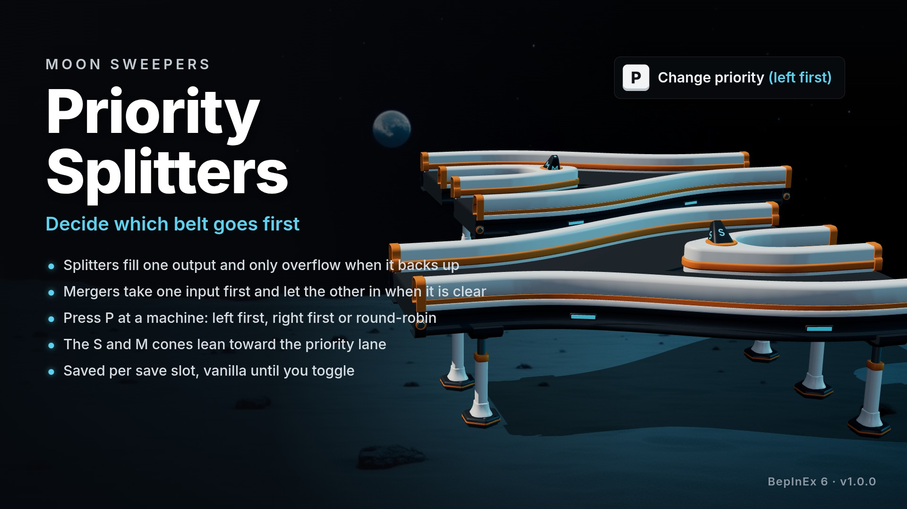

# Priority Splitters

A [BepInEx 6](https://builds.bepinex.dev/projects/bepinex_be) mod for [Moon Sweepers](https://store.steampowered.com/app/5335510/) that gives every splitter a priority output and every merger a priority input.



Vanilla splitters alternate left and right no matter what is waiting on either side, and mergers alternate their inputs the same way. With this mod you walk up to a machine with the hammer out, press **P**, and it cycles through **left first**, **right first** and the vanilla **round-robin**. The S cone on a splitter and the M cone on a merger lean toward the priority lane. Machines you never touch keep behaving exactly like vanilla.

- **Splitter, left first:** every capsule goes left. Only while the left belt is backed up (a capsule standing still at its end) do capsules overflow to the right.
- **Merger, left first:** while anything is waiting at the end of the left belt, the left belt goes in. The right belt only enters while the left end is empty.
- Left and right are as seen looking along the direction the capsules travel.
- Choices are stored per save slot in `BepInEx/config/PrioritySplitters/slot-N.json`, never in the save file. Removing the mod is safe at any time.

## Install

1. Install BepInEx 6.0.0-be.791 (Unity.IL2CPP win-x64) and the [Moon Sweepers BepInEx Patcher](https://www.nexusmods.com/moonsweepers/mods/9). Stock BepInEx cannot load plugins on this game without the patcher.
2. Download the release zip from [Nexus Mods](https://www.nexusmods.com/moonsweepers/mods/80) and extract it into the game folder, so the DLL ends up at `BepInEx/plugins/PrioritySplitters/PrioritySplitters.dll`.
3. Start the game, load a save, take out the hammer and look at a splitter or merger from within 6 m. The game's key prompt shows the toggle key and the current priority.

Tested on Moon Sweepers 1.0.4, on Windows and under Proton on Linux.

## Settings

`BepInEx/config/danbopes.moonsweepers.prioritysplitters.cfg`, created on first start:

| Key | Default | Meaning |
|---|---|---|
| `ToggleKey` | `p` | Key that cycles the priority of the machine you are looking at |
| `HammerOnly` | `true` | Only toggle a machine, and only show its prompt, while the hammer is in hand |
| `ReachMeters` | `6` | How close you must be to toggle a machine and see its prompt |
| `LeanDegrees` | `20` | How far the S and M cones lean; `0` hides the indicator |
| `ShowPrompt` | `true` | Show the key prompt while looking at a machine |
| `GraceSeconds` | `0.2` | How long a capsule must stand still before its lane counts as backed up |
| `ReleaseSeconds` | `1.0` | How long a lane must keep moving before it counts as free again |
| `Enabled` | `true` | `false` restores vanilla behaviour everywhere |
| `DebugRouting` | `false` | Log a routing summary every 5 seconds |

## Known limitations

- A priority can only be chosen once both lanes of a machine have a belt attached.
- Co-op is untested. Routing runs in the simulation, so at least the host should have the mod installed.

## Building

Requirements: the .NET SDK, the game with BepInEx be.791 and the Patcher installed (the Patcher generates the interop assemblies the build references), and `GamePath` pointing at the game folder (`Directory.Build.props` defaults to the Steam location on Linux).

```
dotnet build src -c Debug     # builds and copies the DLL into the game's BepInEx/plugins
dotnet build src -c Release   # builds only
```

The leaning cones are the letter cones cut out of the game's splitter and merger meshes at build time of the mod, not at runtime: `tools/extract_cone.py` (UnityPy, see the script header) writes `src/Resources/*-cone.bin`, which the plugin embeds and splits into a cone-less body and a cone child at runtime. `HANDOFF.md` documents the game internals the mod relies on and the traps met along the way.

## Credits

boverson777 for the BepInEx Patcher that makes modding this game possible, the BepInEx team, and the Il2CppInterop contributors.
